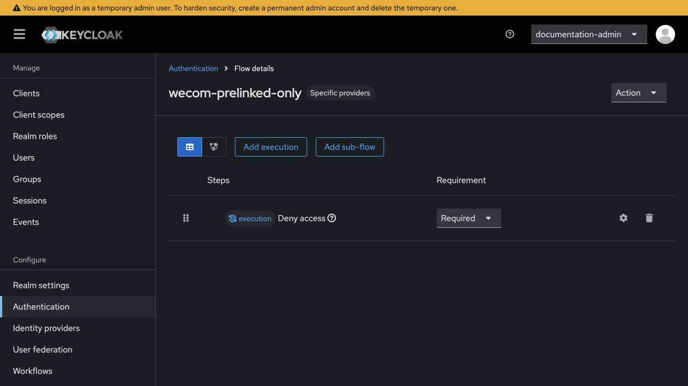
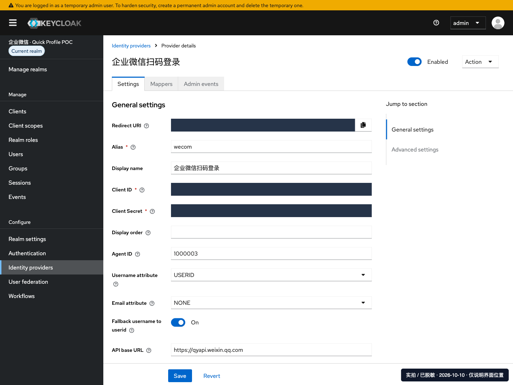
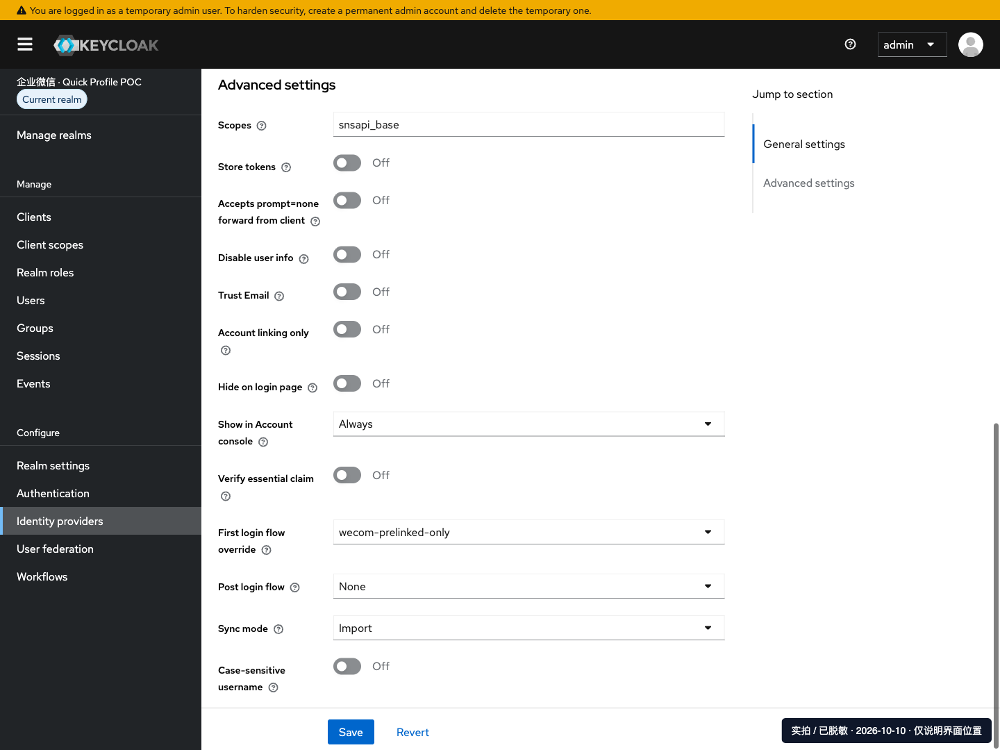
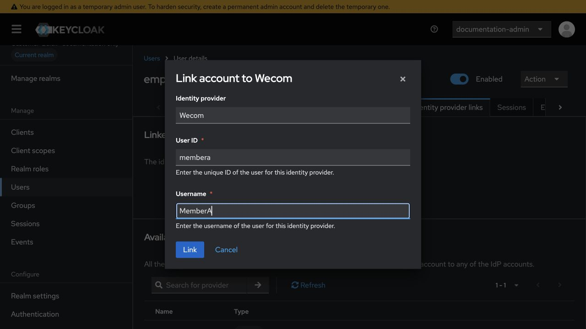

# 企业微信扫码登录 Quick：完整手动配置

> 本页是**初始配置阶段的手工参考**，包含过渡账号和 Link account，不代表临时用户方案已完成。初始配置核对后继续 [管理员映射临时用户实施](管理员映射临时用户实施.md)，最终迁移、会话复用及清理使用专用脚本；不能只删除 Deny 流程就开放自动注册。

**起点：只安装好了 Keycloak 26.6.4 + 社区 wecom 插件，其他业务配置从零开始。** 本文不运行本项目部署脚本，不依赖管理平台，按控制台逐步配置；Quick 的 IAM 联合用户使用一条官方 AWS CLI 命令精确注册，不能用“邀请用户”代替。

适用 AWS 商业分区、兼容 IAM 联合身份的 Quick Enterprise 订阅、`default` namespace。已有 IAM Identity Center/AD 订阅先评审，不转换或覆盖。本文不重装 Keycloak 服务器/数据库，也不迁移旧客户内容。

> 手动与自动化是两种独立实施方式，选一种完成同一 Realm。不要手动建到一半再运行首次部署脚本接管；它会拒绝已有资源。截图中保留的旧名称只用于定位菜单，填写值以本文和客户审批表为准。

顺序：准备参数 → 创建 Realm 和企微 Provider → 创建并绑定员工 → 创建 SAML/Desktop 客户端 → IAM provider/角色 → 回填员工角色 → 注册 Quick 用户 → Quick SSO/扩展 → 扫码验收。

## 1 · 准备参数、订阅与企微应用

### 先记这一张表

以下是演示值，必须替换成客户实际值；同一位员工的用户名和邮箱在后续各处保持一致。Secret 不写入表格。

| 参数 | 本文演示值 | 从哪里获取 |
|---|---|---|
| Keycloak 地址 | `https://sso.example.com` | 已安装服务的 HTTPS 地址 |
| Realm | `customer-quick` | 管理员决定的新名称，不能是 master |
| Issuer | `https://sso.example.com/realms/customer-quick` | 上两项拼接；不要用 master |
| AWS 账户 / Quick 区域 | `123456789012` / `ap-northeast-1` | AWS 右上账户信息 / Quick 实际身份区域 |
| SAML 登录别名 | `quick-web` | 第 5 步自己填写，不从 AWS 获取；同一 Realm 内唯一 |
| SAML Provider 名称 | `CustomerQuickSaml` | 第 6 步创建时填写，同一 AWS 账户内唯一 |
| 员工用户名 / 邮箱 | `employee-e001` / `employee001@example.com` | 客户批准的人员目录 |
| 企业微信 UserId | `MemberA` | 企微通讯录的员工账号，不是显示名 |
| 员工 IAM 角色名 | `CustomerQuick-employee-e001` | 第 6 步创建，每人一个角色 |
| Quick 用户名 | `CustomerQuick-employee-e001/employee-e001` | 第 8 步注册返回值，必须核对 |

### 开通并核对 Quick

AWS 控制台 → Amazon Quick → 目标区域。客户管理员开通支持该方案的 Enterprise / Enterprise and Q，核对费用和 IAM 联合身份兼容性，保留一个不依赖本 Realm 的管理员登录方式。已有符合条件的订阅不重新开通。


**检查：** 管理员可进入 Manage account，身份区域和账户正确。不要取消已有订阅来“重置登录”，这可能影响所有用户和业务内容。

### 企业微信应用与域名

企业微信管理后台 → **应用管理 → 自建 → 创建应用**，加入获批员工的可见范围。记录 CorpID、AgentID；应用 Secret 通过“查看”按企微验证流程获取，仅录入受控密码库和第 3 步的 Keycloak 表单。


同一应用下方 **开发者接口**：

| 配置入口 | 填写内容 |
|---|---|
| 企业微信授权登录 → Web 网页 → 授权回调域 | `sso.example.com`，不带协议/路径 |
| 网页授权及 JS-SDK → 可信域名 | 按后台要求验证同一域名，不能替代上一项 |
| 企业可信 IP | Keycloak 服务器全部实际 NAT 公网出口，不是本机/ALB IP |


要求域名验证时，下载本企业 `WW_verify_*.txt`，由服务器管理员原样发布到域名根路径；浏览器能读取正确内容后再验证。通讯录 → 员工详情 → 账号，核对真实 UserId。**保存并重新打开，确认域名、IP、可见员工均正确。**

## 2 · 创建 Realm 和管理员控制的身份属性

进入 Keycloak `/admin/`，使用管理员身份登录。左上 **Manage realms → Create realm**，Realm name=`customer-quick`、Enabled=On，点 **Create**。以后每一步先看左上角，确保不是 master。

**Realm settings** 逐页保存：

| 页签 | 配置 |
|---|---|
| General | Require SSL=All requests（客户服务为 HTTPS） |
| Login | User registration、Duplicate emails、Edit username、Forgot password 关闭；员工无本地密码 |
| Security defenses → Brute force detection | 开启，按客户策略限制失败次数 |
| Tokens | RS256；Access token=5 分钟；Revoke refresh token=On |
| Sessions | SSO idle=30 分钟，SSO max=8 小时；离线会话按审批策略 |
| Events → Admin events settings | 保存管理事件；不记录请求 representation，避免包含 Secret |


截图中的 Refresh token max reuse=2 为已测试的 Desktop 并发刷新兼容参数，影响整个 Realm，采用前需安全审批；不要关闭刷新令牌轮换。首次部署脚本的离线会话示例为 idle 30 天、max 60 天，不是所有客户必须接受的安全策略。

**Realm settings → User profile**：

1. 分别编辑 `username`、`email`：Permissions 的 **Can view=Admin/User，Can edit=Admin**，不允许员工修改认证映射。
2. 新建属性 **quickRolePair**：单值，Can view/Can edit 都仅 **Admin**；不设 Required，暂时留空，等第 7 步回填。
3. 若 firstName/lastName/email 的 Required 设置会强制扫码后更新资料，取消不必要的 Required，或由管理员提前填齐；不要依赖员工修改受控邮箱来过验证。
4. 员工邮箱必须经管理员核实，即使在全局 profile 中未强制 required，也不能在本方案中留空。

**检查：** 员工不可自行修改用户名、邮箱和 quickRolePair；不向普通员工授予 realm-management 角色。

## 3 · 创建拒绝自动开户的流程，再添加企微 Provider

### 首次登录流程

**Authentication → Flows → Create flow**：

1. Alias=`wecom-prelinked-only`，类型 **Basic flow**，Create。
2. 打开该 flow → **Add execution → Deny Access**。
3. Requirement 设为 **Required**，只有这一条 execution。不要添加自动建用户或按邮箱合并步骤。



此图为隔离的本地 26.6.4 控制台实拍，不是客户部署成功证据。未知企微成员首次扫码应被拒绝；第 4 步显式绑定过的员工不会走自动开户路径。

### 企业微信身份提供方

**Identity providers → Add provider → 企业微信 / wecom**。

| 字段 | 填写值 |
|---|---|
| Alias / Display name | `wecom` / 企业微信扫码登录 |
| Client ID | 本企业 CorpID，不是 AgentID |
| Client Secret | 第 1 步同一企微应用的真实 Secret，不是 SSM 路径 |
| Agent ID | 同一企微应用 AgentID |
| Username attribute / Email attribute | USERID / NONE |
| Fallback username to userid | On |
| Advanced settings → Scopes | `snsapi_base` |
| Trust email / Store tokens / Account linking only | Off |
| First login flow override | `wecom-prelinked-only` |
| Sync mode | Import |
| API/Web login 等地址 | 保留官方默认，不填本机演示地址 |





确认拒绝流程已选中再点 **Add**；建成后将 Provider **Enabled 暂时关闭**，第 10 步才开启。无需添加 broker mapper。回调应为 `https://sso.example.com/realms/customer-quick/broker/wecom/endpoint`。

**检查：** CorpID/AgentID/Secret 属于同一应用；默认官方地址、Import、NONE 邮箱和拒绝流程都已保存。SSM 只是可选密钥保管来源，手动方案不必创建 SSM 参数；把 ARN 或路径填入 Secret 不会自动取值。

## 4 · 手工创建员工并绑定企业微信账号

**Users → Add user**：Username=`employee-e001`，Email=`employee001@example.com`，Enabled=On。管理员已核实邮箱所有权时才设置 Email verified。不要加 Update password 等 required action，不设共享密码；点 **Create**，保存用户 UUID。

### 不用 API，直接在网页绑定

**Users → employee-e001 → Identity provider links**：

1. 在 **Available identity providers** 找到 `wecom` → **Link account**。
2. **User ID** 填真实企微 UserId 转小写：`MemberA` → `membera`。
3. **Username** 填企微原始 UserId：`MemberA`。这里不是 Keycloak 的 employee-e001，也不是邮箱。
4. 核对选中的是正确员工，再点 **Link**。



此图为合成员工、未向客户环境提交的真实界面。26.6.4 的上游控制台已包含 Link account；若看不到，先检查当前管理员是否有 manage-users 及查看 identity providers 的权限，不要给员工升为管理员。

**检查：** Linked identity providers 中显示 `wecom / membera / MemberA`；整个人员表没有大小写折叠后重复的企微 UserId。未知用户不能自动认领同邮箱账号。

> 本文直接使用 Keycloak，不需要管理平台专用的 approval/owner 属性。若之后要接管到管理平台或首次部署脚本，必须另走受控迁移流程，不能伪造部署归属标记。

## 5 · 手动配置 Web SAML 与 Desktop 客户端

### Web SAML

**Clients → Create client → SAML**，Client ID=`urn:amazon:webservices`，保存后按下表设置：

| 页面 / 字段 | 填写值 |
|---|---|
| Valid redirect URIs | `https://signin.aws.amazon.com/saml` |
| Advanced → Fine Grain SAML Endpoint Configuration → Assertion Consumer Service POST Binding URL | `https://signin.aws.amazon.com/saml` |
| Home URL | `https://quicksight.aws.amazon.com` |
| Name ID format / Force name ID format | username / On |
| Force POST binding / Include AuthnStatement | On / On |
| Sign documents / Sign assertions | On / On |
| Settings → Signature and Encryption → Signature algorithm | RSA_SHA256 |
| Keys → Client signature required / Encrypt assertions | Off / Off |
| IdP initiated SSO URL name | `quick-web`，这是自己定义的 SAML 登录别名 |
| IdP initiated SSO Relay state | `https://quicksight.aws.amazon.com` |


在 **Keys** 页关闭客户端签名要求及断言加密；不要在 Settings 的签名算法区域寻找这两个开关。


在 **Advanced → Fine Grain SAML Endpoint Configuration** 填写 POST ACS，保存；其他 Binding URL 没有客户要求时保持空白。


保存后进入 **Client scopes → urn:amazon:webservices-dedicated → Mappers**。空列表点 **Configure a new mapper**；已有条目时点 **Add mapper → By configuration**，逐个创建以下 4 项。若已存在同名/同目标 Attribute 的 mapper，不重复添加。

SAML Attribute Name 的公共前缀是 `https://aws.amazon.com/SAML/Attributes/`，每项 Name format 都选 **URI Reference**。

| Name | Mapper type | SAML Attribute Name 后缀 | 取值字段 |
|---|---|---|---|
| AWS role | User Attribute | Role | User Attribute=`quickRolePair` |
| Employee session | User Property | RoleSessionName | Property=`username` |
| Email tag | User Property | PrincipalTag:Email | Property=`email` |
| Session duration | Hardcoded attribute | SessionDuration | Attribute value=`3600` |


此处采用**每人一个角色 + 用户属性 quickRolePair**，不采用共享的 Hardcoded Role。每项 **Save**；Dedicated scope 的 Full scope allowed=Off，不继承会额外输出 AWS Role 的其他 scope。

**检查：** 4 个 AWS Attribute 各一个，RoleSessionName/NameID 都是 Keycloak username；企微 UserId 不直接作为 AWS session name。最终 SSO 地址为 `https://sso.example.com/realms/customer-quick/protocol/saml/clients/quick-web`。不同 Realm 可以用同一个别名，因为完整 URL 已含 Realm；同一 Realm 内不可冲突。

### Desktop OIDC

**Clients → Create client → OpenID Connect**：

| 配置 | 填写值 |
|---|---|
| Client ID | `amazon-quick-desktop` |
| Client authentication | Off，Public，不需要 Secret |
| Authentication flow | 仅 Standard flow；Direct access grants、Implicit、Service accounts 等关闭 |
| Capability config → Require PKCE | On，Method=S256 |
| Valid redirect URIs | `http://localhost:18080`，不能加通配符 |
| Web origins | 留空，不填 `*` |
| Client scopes | Default=`basic, profile, email`；Optional=`offline_access` |
| Dedicated scope → Scope | Full scope allowed=Off |


按客户策略核对员工具备 `offline_access` realm role（新 Realm 通常通过默认角色包含），只补所需用户角色，不能授予管理角色。保存后打开 Realm 的 `.well-known/openid-configuration`，核对 issuer、authorization_endpoint、token_endpoint 和 jwks_uri 均属于本 Realm。

## 6 · 下载 Metadata，并手工创建 AWS IAM 配置

### 下载本 Realm Metadata XML

浏览器打开：

```text
https://sso.example.com/realms/customer-quick/protocol/saml/descriptor
```

浏览器显示 XML 时，使用 **另存为**，文件名 `customer-quick-metadata.xml`。检查文件不是登录页/HTML，根元素 EntityDescriptor 的 entityID 为本 Realm Issuer，包含 X509Certificate。不需要打开管理平台下载，不能下载 master 的 XML。

### 创建 SAML Provider

AWS → **IAM → Identity providers → Add provider**：类型 SAML，Provider name=`CustomerQuickSaml`，上传上述 XML，点 **Add provider**。


进入详情复制 Provider ARN，例如 `arn:aws:iam::123456789012:saml-provider/CustomerQuickSaml`；检查证书和 issuer。此处 IAM 为全局服务，不由控制台顶部区域决定。

### 每位员工创建一个角色

**IAM → Roles → Create role → Custom trust policy**。粘贴下面 JSON，替换账户、provider 名称、Issuer、用户名、邮箱为同一员工的实际值：

```json
{
  "Version": "2012-10-17",
  "Statement": [{
    "Effect": "Allow",
    "Principal": {"Federated": "arn:aws:iam::123456789012:saml-provider/CustomerQuickSaml"},
    "Action": ["sts:AssumeRoleWithSAML", "sts:TagSession"],
    "Condition": {
      "StringEquals": {
        "SAML:aud": "https://signin.aws.amazon.com/saml",
        "SAML:iss": "https://sso.example.com/realms/customer-quick",
        "SAML:sub": "employee-e001",
        "aws:RequestTag/Email": "employee001@example.com"
      },
      "ForAllValues:StringEquals": {"aws:TagKeys": "Email"},
      "Null": {"aws:RequestTag/Email": "false"}
    }
  }]
}
```

Next → **不勾选任何 AWS 管理权限策略** → Next → Role name=`CustomerQuick-employee-e001` → Create role。用标签注明客户/Realm/员工，便于维护；不要伪造脚本部署归属标签。

角色详情 → **Permissions → Add permissions → Create inline policy → JSON**，粘贴并保存为 `NoAutomaticEnrollment`：

```json
{
  "Version": "2012-10-17",
  "Statement": [{
    "Effect": "Deny",
    "Action": [
      "quicksight:CreateAdmin", "quicksight:CreateUser", "quicksight:CreateReader",
      "quicksight:RegisterUser", "quicksight:UpdateUser"
    ],
    "Resource": "*"
  }]
}
```

该角色只承担登录，不授予 S3/EC2/管理权限；Quick 内业务权限由获批的 Quick 用户角色和内容分享决定。显式 Deny 防止员工登录时自行注册/升级用户。


截图为既有脱敏页面，仅定位 ARN/信任关系，不复用图中旧角色。复制新 Role ARN，检查 Maximum session duration=1 小时，Trust relationships 完整保留上述约束。

**检查：** 每位员工各自一条精确角色信任，不把用户名/邮箱分别放入数组形成交叉授权；没有 AdministratorAccess/其他业务权限。IAM 静态检查不能代替第 10 步真实 SAML/STS 登录。

## 7 · 把角色 ARN 回填到对应 Keycloak 用户

**Keycloak → Users → employee-e001 → Details/Attributes → quickRolePair**（位置随 User profile 表单布局显示），填写为一个完整值：

```text
arn:aws:iam::123456789012:role/CustomerQuick-employee-e001,arn:aws:iam::123456789012:saml-provider/CustomerQuickSaml
```

Role ARN 在前、Provider ARN 在后，中间一个英文逗号；不添加空格、换行或第二个角色。点 **Save** 后重新打开核对。如果字段不存在，回第 2 步建立 admin-only 属性，不要打开全部 unmanaged attributes 给员工自行编辑。

**检查：** 此用户的 username/email 分别与角色信任中的 SAML:sub/Email 相等；角色 ARN 确实已在本客户 AWS 中创建。不要把同一 role pair 复制给其他员工。

## 8 · 手动注册 Quick IAM 联合用户（可能计费）

Quick **Manage account → Identity → Manage users** 用于查看。为了准确指定 Role ARN 与 SessionName，本方案使用公开 RegisterUser 接口；“邀请邮箱”会创建另一种身份，不能替代。

打开目标账户 **AWS CloudShell**。下面每条手动复制执行；不是运行本项目自动化脚本。先输入实际参数并检查目标：

```bash
read -r -p '客户 AWS 账户 ID: ' quick_account
read -r -p 'Quick 身份区域（如 ap-northeast-1）: ' quick_region
read -r -p '第 6 步新建 Role ARN: ' quick_role_arn
read -r -p 'Keycloak username: ' quick_username
read -r -p '已核实的员工邮箱: ' quick_email
read -r -p '已获批许可（READER_PRO 或 AUTHOR_PRO）: ' quick_license
aws sts get-caller-identity --query Account --output text
aws quicksight list-users --aws-account-id "$quick_account" --namespace default --region "$quick_region" --query 'UserList[].{UserName:UserName,Email:Email,Role:Role}'
```

人工确认 STS 返回账户=输入账户，列表中没有目标角色/用户名或同邮箱冲突，Role ARN 与第 7 步一致；许可已由客户批准。**有差异立即停止，不执行下一条，不反复注册。**

确认创建收费用户后，执行一次：

```bash
aws quicksight register-user \
  --aws-account-id "$quick_account" \
  --region "$quick_region" \
  --namespace default \
  --identity-type IAM \
  --iam-arn "$quick_role_arn" \
  --session-name "$quick_username" \
  --email "$quick_email" \
  --user-role "$quick_license" \
  --query 'User.{UserName:UserName,Email:Email,Role:Role,IdentityType:IdentityType,Active:Active}'
```

**检查：** 返回 IdentityType=IAM；UserName=`角色名/Keycloak用户名`；邮箱和许可正确，管理用户页面能查到。记录 Active 状态：首次登录前可能为 false，不因此删除重建；第 10 步登录后再核对激活状态。若网络超时，先重新 ListUsers/DescribeUser 查结果，不盲目再提交。需要组/内容分享时由客户管理员另行批准，不能让新用户继承旧用户内容。

## 9 · 手工填写 Quick Web SSO 与 Desktop 扩展

### Web SSO

**Quick → Manage account → Identity → SSO**：先保留独立管理员应急入口，记录已有设置及受影响用户，避免覆盖别人的登录配置。


| 字段 | 本例填写 |
|---|---|
| IdP / SSO URL | `https://sso.example.com/realms/customer-quick/protocol/saml/clients/quick-web` |
| IdP 重定向 URL 参数 | `RelayState`，大小写一致 |

此 URL 最后的 quick-web 就是第 5 步自己定义的别名，不是 AWS 随机生成的值。不是 Metadata 下载地址，也不是 OIDC auth 地址。

先记录表内待填值，暂不启用账户级重定向。完成第 10 步启用 Provider 后，先直接打开上述 SSO URL 验证扫码进入 Quick；通过后在获批窗口回此页保存并启用 IdP 重定向，再从 Quick 正常入口验证退出重登。页面字段顺序以客户当前界面为准。应急管理员入口为 `https://ap-northeast-1.quicksight.aws.amazon.com/sn/auth/signin?enable-sso=0`，将区域替换为实际身份区域；仍需合法管理员认证。

### Desktop：先 access，再 extension

**Manage account → Permissions → Extension access → Add extension access → Amazon Quick（Desktop application for Quick）→ Next**。


| 字段 | 本例填写 |
|---|---|
| Name | `CustomerQuick-Desktop-access` |
| Issuer URL | `https://sso.example.com/realms/customer-quick` |
| Authorization Endpoint | `https://sso.example.com/realms/customer-quick/protocol/openid-connect/auth` |
| Token Endpoint | `https://sso.example.com/realms/customer-quick/protocol/openid-connect/token` |
| JWKS URI | `https://sso.example.com/realms/customer-quick/protocol/openid-connect/certs` |
| Client ID | `amazon-quick-desktop` |

逐项核对 `.well-known/openid-configuration` 后点 **Add**。Public 客户端没有 Secret；此表单不强行填写不存在的 scopes 字段。所需 `openid profile email offline_access` 已在第 5 步配置。

然后进入 **Quick 主工作区 → Extensions → Create extension**，选择刚创建的 Desktop access → Next/Create，确认 Active。


**检查：** access + extension 两者都存在，并指向同一个 Realm；它们不是每位员工各建一份。OIDC 配置创建后不能直接编辑时，需要客户批准替换窗口后再重建，不能边猜参数边删现有扩展。

## 10 · 启用扫码，按四项验收

回 Keycloak → **Identity providers → wecom → Enabled=On**，保存。先核对所有员工都有正确绑定、角色值和已注册 Quick 用户。

**执行顺序：先直接打开第 9 步的 SSO URL 完成本人扫码 → 管理员回 Quick「身份 → SSO → 编辑」，将「服务提供商启动的 SSO」设为「开启」并保存 → 再验收正常入口和 Desktop。** 此开关是账户级设置，应保留独立管理员入口并在获批窗口启用。只保存 URL 不开启时，直连可以成功，但退出后从正常入口登录可能回到原生用户名页面。

| 验收 | 操作与通过标准 |
|---|---|
| Web 首次登录 | 员工在独立浏览器会话打开第 9 步的 SSO URL → 企业微信扫码 → 本人确认；Quick 用户名、邮箱、许可、可见内容正确 |
| Web 退出重登 | 在 Quick 退出后重新登录，不能落入 AWS 选角色页面、产生新用户或提示身份未配置 |
| Desktop | Extensions 的 Desktop 卡片下载客户端 → Continue with SSO → 客户区域 → 本人扫码 → 本机 localhost:18080 回调；实际进入桌面主界面 |
| 身份与持续使用 | 已获批的不同员工各自验证隔离；获授权但未绑定的测试成员应拒绝；Desktop 多次 token 刷新、休眠恢复及退出重登通过 |

二维码页面、HTTP 200、注册成功或 IAM 策略通过都不能代替上述真实登录。新建员工没有本地密码，不要再用临时密码登录。遇到 Quick 账号/用户选择页，选客户账号下的对应员工，而不是管理员或另一身份。Keycloak 或 Desktop 离线会话有效时可能不再显示二维码；验收首次扫码优先用另一台电脑，确需撤销时只处理获批测试员工的在线和 Desktop 离线会话，不能清除他人会话。

扫码故障需要停用时，将本 Realm 的 wecom Provider 关闭，**只阻断后续扫码，不注销已建立会话、不撤销已签发 STS 凭证，也不停止 Quick 席位计费**。保留独立管理员，不要通过删除整个 Quick 订阅排查登录问题。

## 本页来源与验收边界

- 已有企业微信、Keycloak、Quick、IAM 图片为项目真实界面脱敏截图，旧名称仅说明页面位置。
- 6 张新增 Keycloak 图片来自本机隔离的 26.6.4 + 社区插件、合成员工环境；没有真实企微 Secret，不表示客户扫码成功。
- 手动 Link account 的字段/动作已核对 [Keycloak 26.6.4 UserIdentityProviderLinks](https://github.com/keycloak/keycloak/blob/26.6.4/js/apps/admin-ui/src/user/UserIdentityProviderLinks.tsx) 和 [UserIdPModal](https://github.com/keycloak/keycloak/blob/26.6.4/js/apps/admin-ui/src/user/UserIdPModal.tsx)。
- IAM trust/Deny JSON 与本项目首次部署器的精确单员工策略对照；Bash 示例做语法与参数检查，不在生成文档时执行写入。
- Quick 注册 API 见 [RegisterUser 官方说明](https://docs.aws.amazon.com/quicksight/latest/APIReference/API_RegisterUser.html)。订阅费用、区域能力及客户实际 UI 以实施时为准。
- 本页交付的是初始配置的完整手动路径；最终临时用户切换仍按专用脚本完成。真实客户资源删除、重部署、本人扫码和 Desktop 刷新必须单独记录，不能以这份说明代替验收结果。

## 进入最终方案

本页解释初始 Keycloak / AWS / Quick 配置。进入最终临时用户状态还需要 [管理员映射临时用户实施](管理员映射临时用户实施.md) 的扩展安装、迁移、受控会话、验收与显式清理步骤。迁移脚本会核对精确身份合同；手工值不兼容时必须先评审，不放宽信任或自动改写既有资源。
