# 企业微信扫码登录 Quick：完整手动配置（临时用户模式）

从已有 Keycloak 26.6.4 + 社区 wecom 插件开始，先按 [首次部署第 3 节](扫码登录快速实施.md) 安装附带 JAR、启用 transient-users。本页随后逐项在控制台配置，**全程不创建 Keycloak 员工、不设密码、不做 Link account**。

Quick 必须有兼容 IAM 联合身份的 Enterprise 订阅及 default namespace；不新建服务器、数据库或自动转换 Identity Center/AD。附带扩展与社区插件都必须存在。

手工与自动化路径二选一。同一 Realm 不混用；手动创建的资源没有自动部署状态，不能运行 new_customer.py 强行接管。截图用于定位页面，旧截图名称不是待填写参数。

顺序：企微/订阅 → 空 Realm/属性 → SAML/OIDC → IAM → 收费确认后注册 Quick → 批准映射/临时 IdP/认证流程 → Quick SSO/扩展 → 启用及验收。

## 1 · 准备参数、订阅与企微应用

### 先记这一张表

以下是演示值，必须替换成客户实际值；同一位员工的用户名和邮箱在后续各处保持一致。Secret 不写入表格。

| 参数 | 本文演示值 | 从哪里获取 |
|---|---|---|
| Keycloak 地址 | `https://sso.example.com` | 已安装服务的 HTTPS 地址 |
| Realm | `customer-quick` | 管理员决定的新名称，不能是 master |
| Issuer | `https://sso.example.com/realms/customer-quick` | 上两项拼接；不要用 master |
| AWS 账户 / Quick 区域 | `123456789012` / `ap-northeast-1` | AWS 右上账户信息 / Quick 实际身份区域 |
| SAML 登录别名 | `quick-web` | 第 3 步自己填写，不从 AWS 获取；同一 Realm 内唯一 |
| SAML Provider 名称 | `CustomerQuickSaml` | 第 4 步创建时填写，同一 AWS 账户内唯一 |
| 员工用户名 / 邮箱 | `employee-e001` / `employee001@example.com` | 客户批准的人员目录 |
| 企业微信 UserId | `membera` | 企微通讯录的员工账号，不是显示名 |
| 员工 IAM 角色名 | `CustomerQuick-employee-e001` | 第 4 步创建，每人一个角色 |
| Quick 用户名 | `CustomerQuick-employee-e001/employee-e001` | 第 5 步注册返回值，必须核对 |

### 开通并核对 Quick

AWS 控制台 → Amazon Quick → 目标区域。客户管理员开通支持该方案的 Enterprise / Enterprise and Q，核对费用和 IAM 联合身份兼容性，保留一个不依赖本 Realm 的管理员登录方式。已有符合条件的订阅不重新开通。

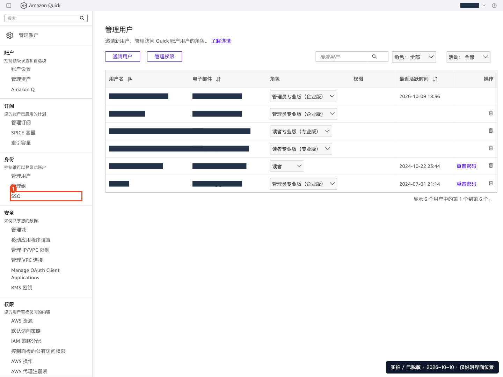

**检查：** 管理员可进入 Manage account，身份区域和账户正确。不要取消已有订阅来“重置登录”，这可能影响所有用户和业务内容。

### 企业微信应用与域名

企业微信管理后台 → **应用管理 → 自建 → 创建应用**，加入获批员工的可见范围。记录 CorpID、AgentID；应用 Secret 通过“查看”按企微验证流程获取，仅录入受控密码库和第 6 步的 Keycloak 表单。

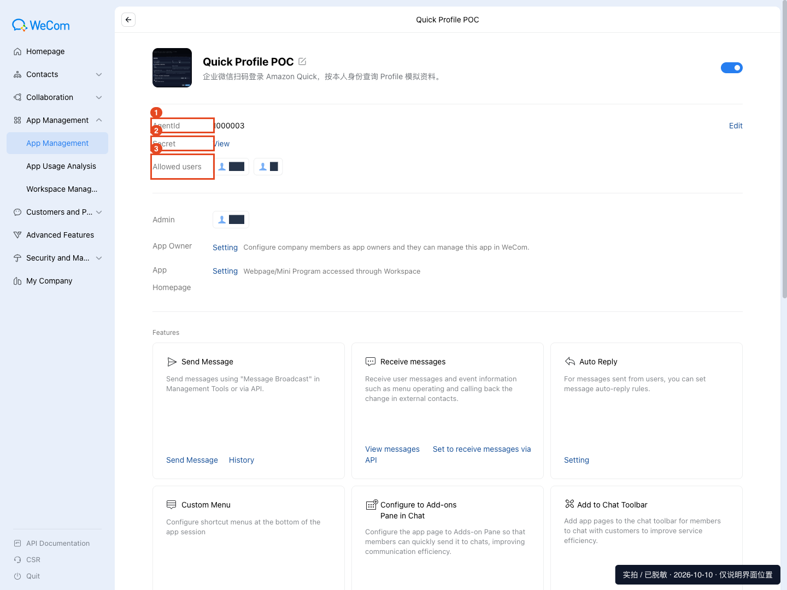

同一应用下方 **开发者接口**：

| 配置入口 | 填写内容 |
|---|---|
| 企业微信授权登录 → Web 网页 → 授权回调域 | `sso.example.com`，不带协议/路径 |
| 网页授权及 JS-SDK → 可信域名 | 按后台要求验证同一域名，不能替代上一项 |
| 企业可信 IP | Keycloak 服务器全部实际 NAT 公网出口，不是本机/ALB IP |

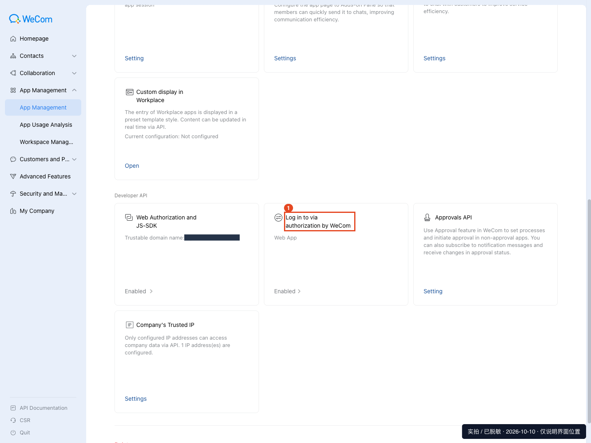

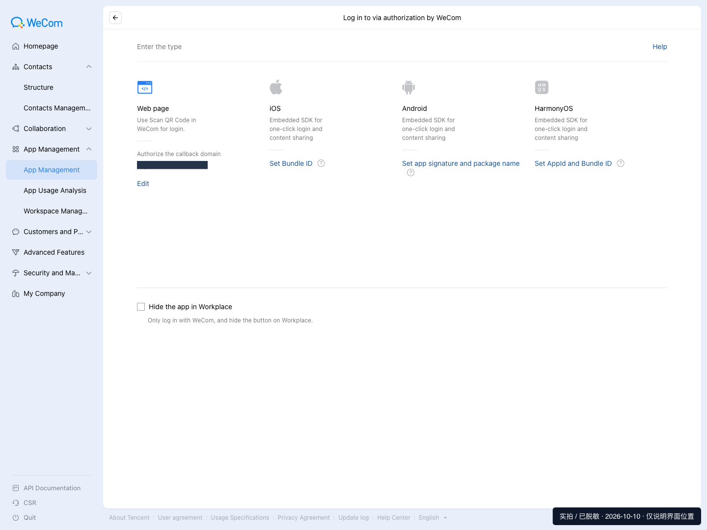

要求域名验证时，下载本企业 `WW_verify_*.txt`，由服务器管理员原样发布到域名根路径；浏览器能读取正确内容后再验证。通讯录 → 员工详情 → 账号，核对真实 UserId。**保存并重新打开，确认域名、IP、可见员工均正确。**

## 2 · 创建 Realm 和管理员控制的身份属性

进入 Keycloak `/admin/`，使用管理员身份登录。左上 **Manage realms → Create realm**，Realm name=`customer-quick`、Enabled=On，点 **Create**。以后每一步先看左上角，确保不是 master。

**Realm settings** 按下表配置。Login 页的开关自动保存，等待成功提示；其他页填写后点 **Save**。切换页签后等数据加载完成，再检查当前值。

| 页签 | 配置 |
|---|---|
| General | Require SSL=All requests（客户服务为 HTTPS） |
| Login | User registration、Duplicate emails、Edit username、Forgot password 关闭；Login with email、Remember me 也关闭；不建立员工账号 |
| Security defenses → Brute force detection | 模式选 Lockout temporarily（临时锁定），按客户策略设置 Max login failures 等限制 |
| Tokens | RS256；Access token=5 分钟；Revoke refresh token=On |
| Sessions | SSO idle=30 分钟，SSO max=8 小时；离线会话按审批策略 |
| Events → Admin events settings | 保存管理事件；不记录请求 representation，避免包含 Secret |

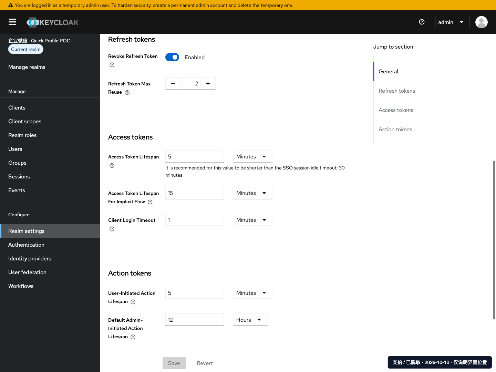

截图中的 Refresh token max reuse=2 为已测试的 Desktop 并发刷新兼容参数，影响整个 Realm，采用前需安全审批；不要关闭刷新令牌轮换。首次部署脚本的离线会话示例为 idle 30 天、max 60 天，不是所有客户必须接受的安全策略。

**Realm settings → User profile**：

1. 分别编辑 `username`、`email`：在编辑页的 **Who can view?** 勾选 Admin/User，**Who can edit?** 只勾选 Admin，不允许员工修改认证映射；不需要找单独的 Permissions 页签。
2. 新建四个单值属性：`quickRolePair`、`quickMappedSubject`、`quickMappedPolicy`、`quickMappedWecomId`。Who can view?/Who can edit? 都仅勾选 **Admin**，均不设 Required。新属性的 Admin 查看权限可能默认未勾选，需明确勾选。这些值由登录 mapper 放到临时身份上，不是在 Users 页面填写。
3. 分别编辑 `firstName`、`lastName`、`email`，将 **Required** 设为 Off（新 Realm 默认可能为 On），避免扫码后被要求更新资料；不要依赖员工修改受控邮箱来过验证。每项修改后保存。
4. 员工邮箱必须经管理员核实，即使在全局 profile 中未强制 required，也不能在本方案中留空。

**检查：** Users 列表应为空；临时身份的用户名、邮箱及四个受控属性不可自行修改；不向普通员工授予 realm-management 角色。

## 3 · 手动配置 Web SAML 与 Desktop 客户端

### Web SAML

**Clients → Create client**：Client type 选 **SAML**，Client ID=`urn:amazon:webservices`，点 **Next**。在 Login settings 填写下表的 Home URL、Valid redirect URIs、IdP initiated SSO URL name 和 Relay state，点 **Save**；其余项在创建后继续配置。Root URL、Valid post logout redirect URIs、Master SAML Processing URL 无客户要求时留空。

| 页面 / 字段 | 填写值 |
|---|---|
| Valid redirect URIs | `https://signin.aws.amazon.com/saml` |
| Advanced → Fine Grain SAML Endpoint Configuration → Assertion Consumer Service POST Binding URL | `https://signin.aws.amazon.com/saml` |
| Home URL | `https://quicksight.aws.amazon.com` |
| Name ID format / Force name ID format | username / On |
| Force POST binding / Include AuthnStatement | On / On |
| Sign documents / Sign assertions | On / On |
| Settings → Signature and Encryption → Signature algorithm | RSA_SHA256 |
| Keys → Client signature required / Encrypt assertions | Off / Off |
| IdP initiated SSO URL name | `quick-web`，这是自己定义的 SAML 登录别名 |
| IdP initiated SSO Relay state | `https://quicksight.aws.amazon.com` |

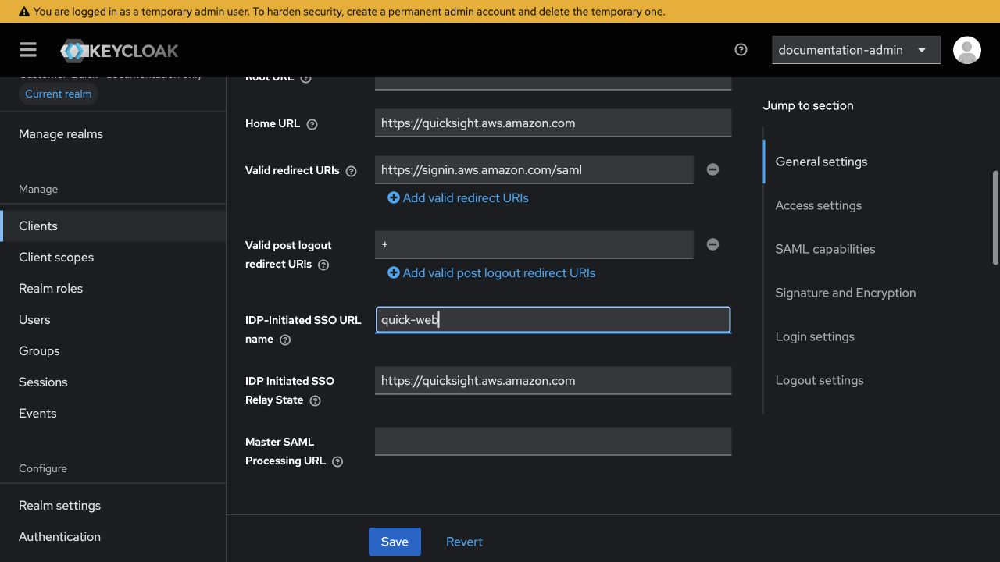

在 **Keys** 页关闭客户端签名要求及断言加密；不要在 Settings 的签名算法区域寻找这两个开关。

关闭 Client signature required 时会出现确认框，点 **Yes** 后检查为 Off。这里只是不要求 AWS 对认证请求签名；**Sign documents 和 Sign assertions 必须保持 On**，不要把 Keycloak 输出断言的签名一起关闭。

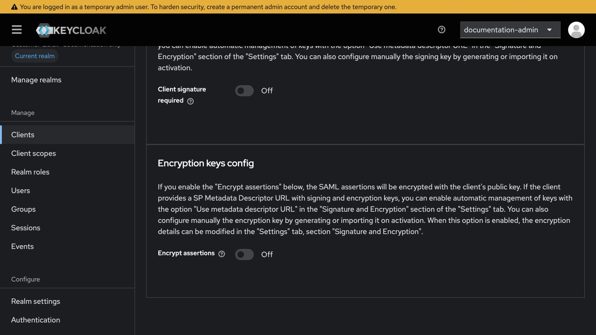

在 **Advanced → Fine Grain SAML Endpoint Configuration** 填写 POST ACS，保存；其他 Binding URL 没有客户要求时保持空白。

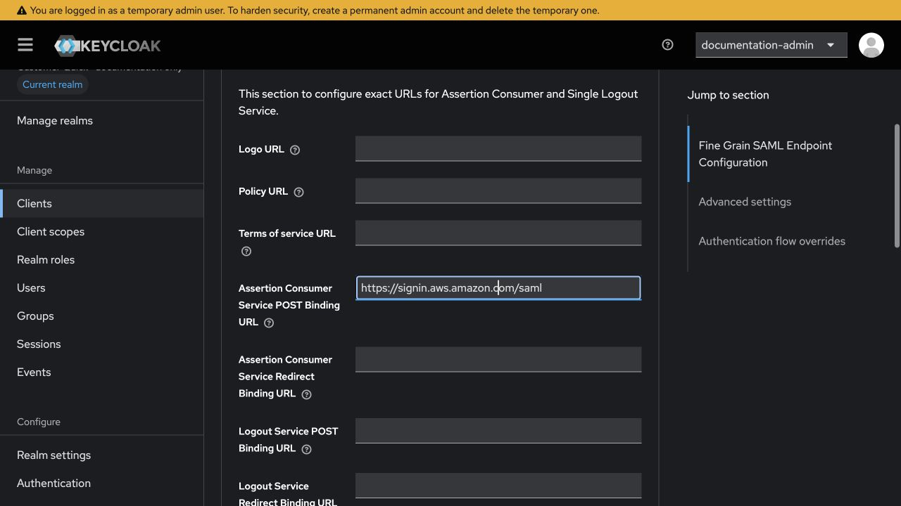

保存后进入 **Client scopes → urn:amazon:webservices-dedicated → Mappers**。空列表点 **Configure a new mapper**；已有条目时点 **Add mapper → By configuration**，逐个创建以下 4 项。若已存在同名/同目标 Attribute 的 mapper，不重复添加。

SAML Attribute Name 的公共前缀是 `https://aws.amazon.com/SAML/Attributes/`，每项 Name format 都选 **URI Reference**。

| Name | Mapper type | SAML Attribute Name 后缀 | 取值字段 |
|---|---|---|---|
| AWS role | User Attribute | Role | User Attribute=`quickRolePair` |
| Employee session | User Property | RoleSessionName | Property=`username` |
| Email tag | User Property | PrincipalTag:Email | Property=`email` |
| Session duration | Hardcoded attribute | SessionDuration | Attribute value=`3600` |

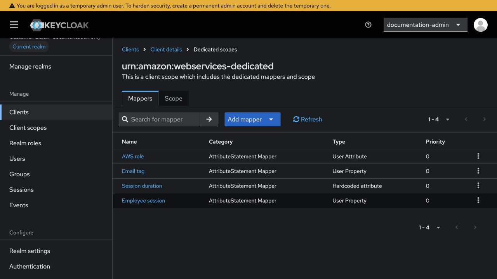

此处采用**每人一个角色 + 临时身份属性 quickRolePair**，不采用共享的 Hardcoded Role。每项 **Save**；Dedicated scope 的 Full scope allowed=Off，不继承会额外输出 AWS Role 的其他 scope。

**检查：** 4 个 AWS Attribute 各一个，RoleSessionName/NameID 都是 批准映射中的 username；企微 UserId 不直接作为 AWS session name。最终 SSO 地址为 `https://sso.example.com/realms/customer-quick/protocol/saml/clients/quick-web`。不同 Realm 可以用同一个别名，因为完整 URL 已含 Realm；同一 Realm 内不可冲突。

### Desktop OIDC

**Clients → Create client → OpenID Connect**：

| 配置 | 填写值 |
|---|---|
| Client ID | `amazon-quick-desktop` |
| Client authentication | Off，Public，不需要 Secret |
| Authentication flow | 仅 Standard flow；Direct access grants、Implicit、Service accounts 等关闭 |
| Capability config → Require PKCE | On，Method=S256 |
| Valid redirect URIs | `http://localhost:18080`，不能加通配符 |
| Web origins | 留空，不填 `*` |
| Client scopes | Default=`basic, profile, email`；Optional=`offline_access` |
| Dedicated scope → Scope | Full scope allowed=Off |

创建向导依次为 **General settings → Capability config → Login settings → Save**。创建后打开 **Client scopes → Setup**，不能仅依赖系统默认分配：

1. 保留 `amazon-quick-desktop-dedicated`（Assigned type=None），这是当前客户端专用配置，不能移除。
2. `basic`、`profile`、`email` 保持 **Default**；`offline_access` 保持 **Optional**。
3. 核对其余自动分配项，例如 `acr`、`address`、`microprofile-jwt`、`organization`、`phone`、`roles`、`web-origins`；在**当前客户端**列表勾选这些多余项，通过列表上方 **⋮ → Remove** 取消分配。不是去 Realm 的 Client scopes 页面删除共享定义，也不改其他客户端。列表分多页时先调大每页数量，避免漏项。
4. 最终列表应有上述四个 scope 加一个 dedicated，共 5 行。进入 dedicated 的 **Scope** 页，关闭 **Full scope allowed**；此开关自动保存，等待成功提示再离开。

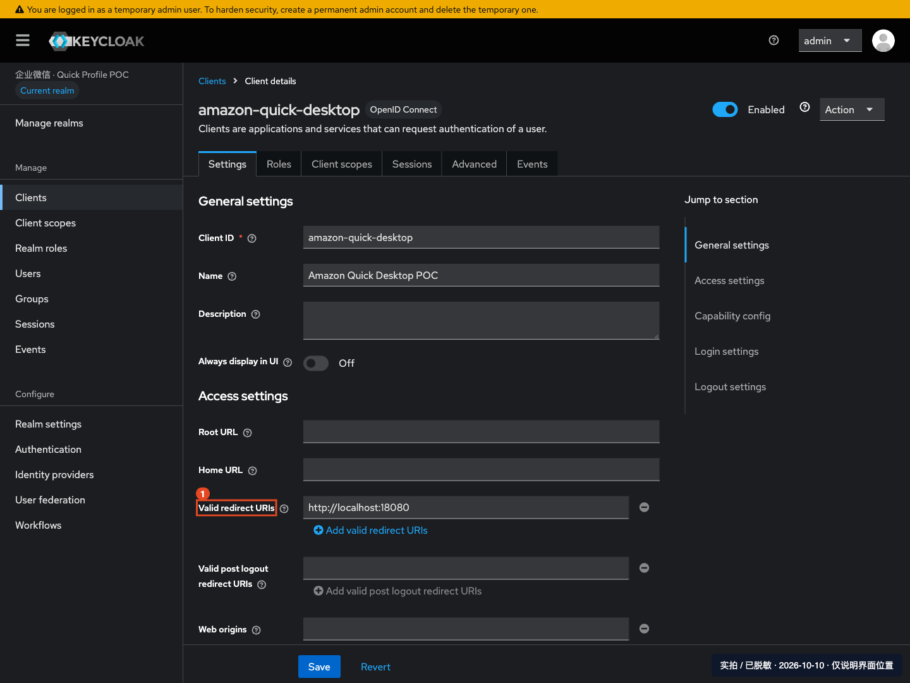

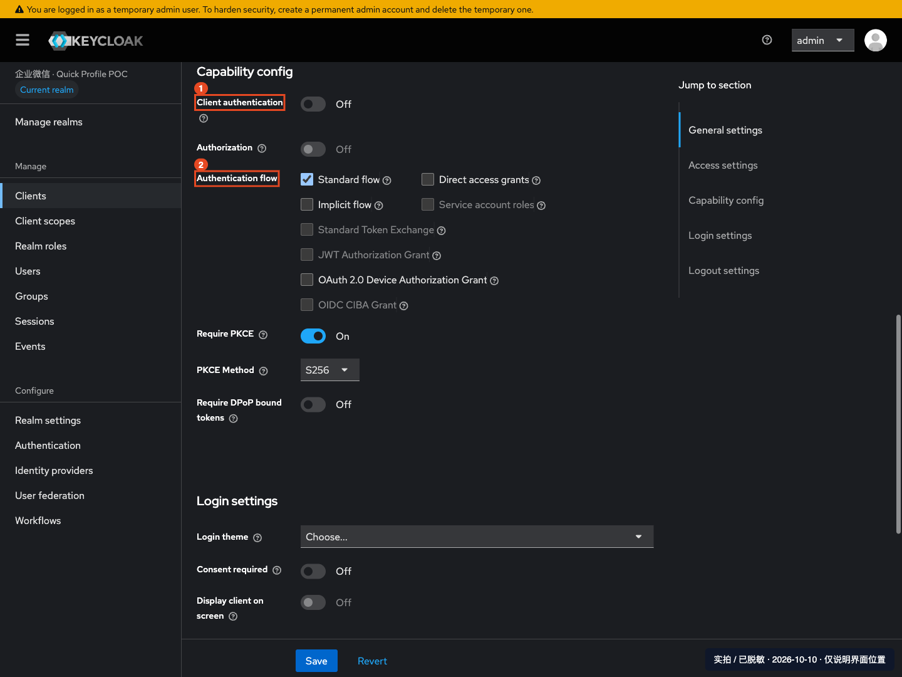

第 6 步通过 IdP 的 Hardcoded Role mapper 仅赋予临时身份 `offline_access`，不要去 Users 添加角色。保存后打开 Realm 的 `.well-known/openid-configuration`，核对 issuer、authorization_endpoint、token_endpoint 和 jwks_uri 均属于本 Realm。

### Desktop 稳定 sub mapper（不能遗漏）

进入 **Client scopes → amazon-quick-desktop-dedicated → Mappers**：空列表点 **Configure a new mapper**；已有条目时点 **Add mapper → By configuration**，然后选择 **User Attribute**：

| 字段 | 值 |
|---|---|
| Name | Approved stable Quick subject |
| User Attribute / Token Claim Name | quickMappedSubject / sub |
| Claim JSON Type | String |
| Multivalued / Aggregate attribute values | Off / Off |
| Add to ID token / access token / userinfo / introspection | 全部 On |

User Attribute 是可输入的属性选择框，填写 `quickMappedSubject`；不要误选 **Subject (sub)** 或 **User Property** 类型。表单加载时属性框可能稍后出现，等字段齐全后再保存。

保存。OIDC sub 来自第 6 步固定的 subject，**不能用每次会话临时生成的内部 ID**。SAML NameID 则仍为 username，两者不是同一个参数。

## 4 · 下载 Metadata，并手工创建 AWS IAM 配置

### 下载本 Realm Metadata XML

浏览器打开：

```text
https://sso.example.com/realms/customer-quick/protocol/saml/descriptor
```

浏览器显示 XML 时，使用 **另存为**，文件名 `customer-quick-metadata.xml`。检查文件不是登录页/HTML，根元素 EntityDescriptor 的 entityID 为本 Realm Issuer，包含 X509Certificate。不需要打开管理平台下载，不能下载 master 的 XML。

若浏览器无法打开或保存 XML，可在 macOS / Linux 终端或 AWS CloudShell 执行以下下载命令（先替换域名和 Realm）：

```bash
curl --fail --silent --show-error --no-clobber \
  --output customer-quick-metadata.xml \
  'https://sso.example.com/realms/customer-quick/protocol/saml/descriptor'
```

文件保存在**当前目录**，再从 IAM 表单的「选择文件」上传。若在 CloudShell 下载，先用 **Actions → Download file** 将该 XML 下载到本机，再上传到 IAM；不是在本机文件选择框里寻找 CloudShell 的文件。避免同目录保留多份旧 XML；重建 Realm 后必须重新下载，不能复用旧证书。下载命令本身不创建 AWS 资源。

### 创建 SAML Provider

AWS → **IAM → Identity providers → Add provider**：类型 SAML，Provider name=`CustomerQuickSaml`，上传上述 XML，点 **Add provider**。

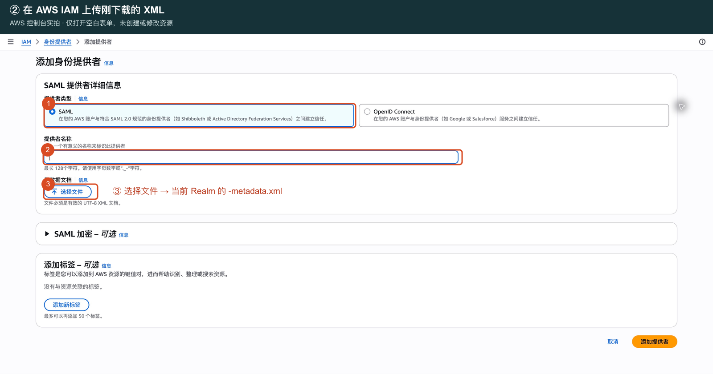

进入详情复制 Provider ARN，例如 `arn:aws:iam::123456789012:saml-provider/CustomerQuickSaml`；检查证书和 issuer。此处 IAM 为全局服务，不由控制台顶部区域决定。

### 每位员工创建一个角色

**IAM → Roles → Create role → Custom trust policy**。粘贴下面 JSON，替换账户、provider 名称、Issuer、用户名、邮箱为同一员工的实际值：

```json
{
  "Version": "2012-10-17",
  "Statement": [{
    "Effect": "Allow",
    "Principal": {"Federated": "arn:aws:iam::123456789012:saml-provider/CustomerQuickSaml"},
    "Action": ["sts:AssumeRoleWithSAML", "sts:TagSession"],
    "Condition": {
      "StringEquals": {
        "SAML:aud": "https://signin.aws.amazon.com/saml",
        "SAML:iss": "https://sso.example.com/realms/customer-quick",
        "SAML:sub": "employee-e001",
        "aws:RequestTag/Email": "employee001@example.com"
      },
      "ForAllValues:StringEquals": {"aws:TagKeys": "Email"},
      "Null": {"aws:RequestTag/Email": "false"}
    }
  }]
}
```

Next → **不勾选任何 AWS 管理权限策略** → Next → Role name=`CustomerQuick-employee-e001` → Create role。用标签注明客户/Realm/员工，便于维护；不要伪造脚本部署归属标签。

角色详情 → **Permissions → Add permissions → Create inline policy → JSON**，粘贴并保存为 `NoAutomaticEnrollment`：

```json
{
  "Version": "2012-10-17",
  "Statement": [{
    "Effect": "Deny",
    "Action": [
      "quicksight:CreateAdmin", "quicksight:CreateUser", "quicksight:CreateReader",
      "quicksight:RegisterUser", "quicksight:UpdateUser"
    ],
    "Resource": "*"
  }]
}
```

该角色只承担登录，不授予 S3/EC2/管理权限；Quick 内业务权限由获批的 Quick 用户角色和内容分享决定。显式 Deny 防止员工登录时自行注册/升级用户。

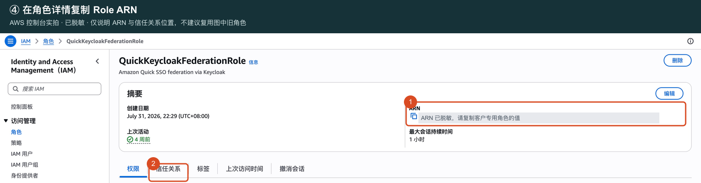

截图为既有脱敏页面，仅定位 ARN/信任关系，不复用图中旧角色。复制新 Role ARN，检查 Maximum session duration=1 小时，Trust relationships 完整保留上述约束。

**检查：** 每位员工各自一条精确角色信任，不把用户名/邮箱分别放入数组形成交叉授权；没有 AdministratorAccess/其他业务权限。IAM 静态检查不能代替第 8 步真实 SAML/STS 登录。

## 5 · 手动注册 Quick IAM 联合用户（可能计费）

Quick **Manage account → Identity → Manage users** 用于查看。为了准确指定 Role ARN 与 SessionName，本方案使用公开 RegisterUser 接口；“邀请邮箱”会创建另一种身份，不能替代。

打开目标账户 **AWS CloudShell**。下面每条手动复制执行；不是运行本项目自动化脚本。先输入实际参数并检查目标：

```bash
read -r -p '客户 AWS 账户 ID: ' quick_account
read -r -p 'Quick 身份区域（如 ap-northeast-1）: ' quick_region
read -r -p '第 4 步新建 Role ARN: ' quick_role_arn
read -r -p '批准映射 username: ' quick_username
read -r -p '已核实的员工邮箱: ' quick_email
read -r -p '已获批许可（READER_PRO 或 AUTHOR_PRO）: ' quick_license
aws sts get-caller-identity --query Account --output text
aws quicksight list-users --aws-account-id "$quick_account" --namespace default --region "$quick_region" --query 'UserList[].{UserName:UserName,Email:Email,Role:Role}'
```

人工确认 STS 返回账户=输入账户，列表中没有目标角色/用户名或同邮箱冲突，Role ARN 与第 4 步一致；许可已由客户批准。**有差异立即停止，不执行下一条，不反复注册。**

确认创建收费用户后，执行一次：

```bash
aws quicksight register-user \
  --aws-account-id "$quick_account" \
  --region "$quick_region" \
  --namespace default \
  --identity-type IAM \
  --iam-arn "$quick_role_arn" \
  --session-name "$quick_username" \
  --email "$quick_email" \
  --user-role "$quick_license" \
  --query 'User.{UserName:UserName,Email:Email,Role:Role,IdentityType:IdentityType,Active:Active}'
```

**检查：** 返回 IdentityType=IAM；UserName=`角色名/批准的会话用户名`；邮箱和许可正确，管理用户页面能查到。记录 Active 状态：首次登录前可能为 false，不因此删除重建；第 8 步登录后再核对激活状态。若网络超时，先重新 ListUsers/DescribeUser 查结果，不盲目再提交。需要组/内容分享时由客户管理员另行批准，不能让新用户继承旧用户内容。

## 6 · 批准映射、临时 Provider 和认证流程

本节是新模式的关键：**不进入 Users 创建用户，不做 Identity provider links / Link account，也不设置密码。** 映射是管理员配置，不是 Keycloak 员工账号。

### 6.1 建立本客户批准映射

每名员工用一次 `python3 -c 'import uuid; print(uuid.uuid4())'` 生成稳定 subject，记录并永久沿用。它不对应数据库中的用户行。重复部署/改文档不能重新生成。

Realm ID 是内部 UUID，不是 Realm 名称。已有经过批准的 kcadm 管理会话可只读查询：

```bash
# 在 Keycloak 安装目录执行；config credentials 会提示输入密码，不在命令里填密码。
bin/kcadm.sh config credentials --server https://sso.example.com --realm master --user YOUR_ADMIN_USERNAME
bin/kcadm.sh get realms/customer-quick --fields id,realm
```

替换地址、Realm、管理员名；MFA 环境使用客户批准的管理 API 会话，不关闭 MFA。kcadm 默认保存管理凭据/令牌，使用隔离维护终端并按客户策略保护、结束会话。

在受控终端用编辑器保存 `approved-mapping.json`。下例 **所有值必须替换**；只有 schema/alias/字段名固定。users 支持 1–25 人，UserId/username 为小写 2–64 位字母、数字、点、下划线或连字符。邮箱、UserId、username、subject 均不可重复。

```json
{
  "schema": 1,
  "realm": "customer-quick",
  "realm_id": "11111111-1111-4111-8111-111111111111",
  "alias": "wecom-mapped",
  "corp_id": "ww0000000000000000",
  "agent_id": "1000003",
  "aws_account": "123456789012",
  "users": [{
    "wecom_user_id": "membera",
    "username": "employee-e001",
    "email": "employee001@example.com",
    "subject": "22222222-2222-4222-8222-222222222222",
    "role_pair": "arn:aws:iam::123456789012:role/CustomerQuick-employee-e001,arn:aws:iam::123456789012:saml-provider/CustomerQuickSaml",
    "enabled": true
  }]
}
```

role_pair 来自第 4 步：Role ARN 在前、SAML Provider ARN 在后，中间一个英文逗号。username/email 必须匹配 IAM 信任和第 5 步 Quick 用户，不把企微显示名或邮箱拿来猜身份。

下面只在本地验证/规范化 JSON、输出指纹，不访问任何服务：

```bash
chmod 600 approved-mapping.json
python3 -c 'import sys,json; sys.path.insert(0,"scripts"); import mapped_transient as m; p=m.validate_policy(json.load(open("approved-mapping.json"))); print(m.canonical(p)); print("SHA256:",m.fingerprint(p))'
```

第一行是待粘贴的**完整单行 JSON**，第二行是第 6.3 节所需指纹。只复制第一行、不含换行到 mapper 字段。指纹对原始 JSON 字节计算；增加空格/换行或改名单都需重新规范化并更新指纹。这是离线辅助计算，不运行自动部署。保存受控备份，不上传 GitHub。

### 6.2 创建暂时停用的企微 Provider

**先保护首次登录，再创建 Provider。** 当前 Keycloak 26.6.4 的 **Add Wecom provider** 创建页只有基本连接字段，没有 Enabled、Do not store users 和 First login flow override；不要假设创建页能一次填写下表全部选项。

1. 在 **Authentication → Flows → Create flow** 新建 **Basic flow**；页面 **Name**（即流程 Alias）填 `quick-mapped-first`。进入流程点 **Add execution → Deny access → Add**，将新执行器默认的 **Disabled** 改为 **Required**，等待成功提示。
2. 在这个流程右上角点 **Action → Bind flow**，**Choose binding type** 选 **First broker login flow** 后保存。不是 Browser flow。确认仅本次新建业务 Realm 的首次第三方登录被拒绝，未改 master；在尚无员工及其他 IdP 的新 Realm 执行此步骤。默认绑定生效前不要创建 Provider。
3. 进入 **Identity providers**，选择 **企业微信**（类型 `wecom`）。创建页填 Alias=`wecom-mapped`、Display name、CorpID（Client ID）、Agent ID、Secret；Username attribute=`USERID`、Email attribute=`NONE`、Fallback username to userid=On，两个端点保留官方默认，点 **Add**。这一步不会创建员工；默认首次登录拒绝流程用于保护创建后的配置间隔。
4. 创建成功后，编辑页顶部 **Enabled** 默认开启。关闭它，在 **Disable provider?** 弹窗点 **Disable**；此开关自动保存，确认顶部开关关闭后再填写其他字段。
5. 在 **Advanced settings** 补齐下表。先确认 **Sync mode=Import**，再开启 **Do not store users**（开启后 Sync mode 控件会隐藏，这是正常现象）；First login flow override 明确选 `quick-mapped-first`，最后点页面底部 **Save**。核对回调带 `wecom-mapped`，直至第 8 步才启用 Provider。

最终配置如下。若后续编辑页也找不到临时用户选项，保持登录拒绝、停用 Provider 后停止排查，不能改为普通持久用户：

| 字段 | 值 |
|---|---|
| Alias / Display name | wecom-mapped / 企业微信扫码登录 |
| Client ID / Agent ID / Client Secret | 当前客户 CorpID / AgentID / 同应用真实 Secret |
| Username attribute / Email attribute | USERID / NONE |
| Fallback to UserId / Scopes | On / snsapi_base |
| Sync mode | Import |
| Do not store users | **On**，对应 doNotStoreUsers=true |
| Trust email | On，邮箱来自管理员批准，不代表企微校验过邮箱 |
| Store tokens / Add read token role / Account linking only | Off |
| First login flow override | quick-mapped-first |
| Post login flow | 留空 |
| API / Web login 等端点 | 官方默认，不能填本地测试服务 |

回调必须是 `https://sso.example.com/realms/customer-quick/broker/wecom-mapped/endpoint`。企微只填域名的界面仍填 `sso.example.com`。找不到 Do not store users 时停止，检查服务器版本、transient-users feature 和附带扩展，不能改用旧用户绑定。

进入该 Provider 的 **Mappers → Add mapper**，只建两项：

| Name | Mapper type | 配置 |
|---|---|---|
| Approved transient identities | Quick approved transient mapping | Sync mode override=Import；Approved mapping policy JSON=6.1 输出的完整单行 JSON |
| Transient offline access | Hardcoded Role | Sync mode override=Import；Role=offline_access |

第二项的 Role 不是文本框：点 **Select Role → Realm roles**，只勾选 `offline_access`，点 **Assign** 回到表单；看到 Role 下已显示 `offline_access` 后再点 **Save**。不是选 `default-roles-客户Realm`，也不是去 Users 分配角色。两项分别保存后，Mappers 列表应恰好有上述两行。

第一项内部类型为 `quick-wecom-mapped-transient-v1`。看不到该类型就说明扩展未加载。该 mapper 根据已验证 UserId 填入临时身份的 username、email、quickRolePair、稳定 subject 和策略指纹，拒绝未获批成员。

### 6.3 配置首次登录校验和受控会话

保持 Provider 停用，删除刚才的临时 Deny execution，然后把 `quick-mapped-first` 配为下表。点 **Add sub-flow**，填写 Name，**Flow type 选 Generic** 后点 Add；新增子流程默认 Disabled，改为 **Conditional**。这里的 Generic 对应底层 basic-flow，和顶层创建页的“Basic flow”名称不同。按表顺序排列，不能加入 Review Profile、自动按邮箱关联或认证已有用户。

| 顺序 | execution / 子流程 | Requirement |
|---|---|---|
| 10 | Create User If Unique（idp-create-user-if-unique） | Required |
| 20 | quick-mapped-unknown | Conditional |
| 30 起，每员工一支 | quick-mapped-email-0、quick-mapped-email-1… | Conditional |
| 最后 | quick-mapped-policy-check | Conditional |

**Create User If Unique 在本方案中只创建临时身份**，前提是该 Provider 的 Do not store users=On；扩展会拒绝持久用户，不能把它放到普通 IdP 上。

在每个子流程**所在行**点 **Add → Add condition → Condition - user attribute → Add** 添加条件；不要在顶层添加，也不要去 Add execution 中找条件。将新增条件默认的 Disabled 改为 **Required**，再点该条件行的 **Settings** 填表。最后在同一子流程行点 **Add → Add execution → Deny access → Add**，同样改为 Required。

条件配置窗口中，Alias 填唯一的说明性名称（如 `mapped-unknown`、`mapped-email-0-user`、`mapped-email-0-value`、`mapped-policy-check`）；**Attribute name** 是属性名，**Expected attribute value** 是期望值，**Negate output** 对应下表的 Not，**regex** 对应 Regex。Authenticator Reference / Max Age 保持空白，逐个点 Save 保存。

| 子流程 | 条件，按顺序 | 配置 |
|---|---|---|
| quick-mapped-unknown | username 不在批准名单 | Attribute=username；Expected value=`(?:employee-e001)`，多人如 `(?:employee-e001|employee-e002)`；Regex=true；Not=true |
| quick-mapped-email-0 | username 是第 1 人，且 email 不等于其邮箱 | 条件1：username / employee-e001 / Regex=false / Not=false；条件2：email / employee001@example.com / Regex=false / Not=true |
| quick-mapped-email-1… | 每位其他员工的对应 username + email | 同上逐人填写，不把多人的邮箱放进同一个条件 |
| quick-mapped-policy-check | quickMappedPolicy 不是批准指纹 | Attribute=quickMappedPolicy；Expected value=6.1 的 SHA256；Regex=false；Not=true |

所有条件 **Include group attributes=false**。用户名含点时，在 unknown 的正则里转义为 `\.`。条件成立才走 Deny，所以 unknown 或任意不一致都拒绝；不要把 Not 配反。

再创建三个 **顶层 Basic flow**（两个拒绝流程的行为相同，分别用于不同绑定）：

| Flow | execution（按顺序） |
|---|---|
| quick-mapped-deny | Deny Access，Required |
| quick-mapped-reset-deny | Deny Access，Required；可由 quick-mapped-deny 的 Action → Duplicate 复制并改名 |
| quick-mapped-sso-browser | Quick approved transient SSO（quick-wecom-mapped-cookie-v1），Alternative；Identity Provider Redirector，Alternative |

为 Redirector 添加配置，Alias=`quick-mapped-sso-redirect`、Default Identity Provider=`wecom-mapped`。不能用普通 Cookie（auth-cookie）替代自建认证器。可把 Browser flow Description 记为 `Approved transient SSO 指纹`，便于核对。

通过各流程右上角的 **Action → Bind flow → Choose binding type** 保存绑定（本版界面没有单独的 Bindings 页签）：

| 进入的流程 | Choose binding type |
|---|---|
| quick-mapped-sso-browser | Browser flow |
| quick-mapped-deny | Direct grant flow |
| quick-mapped-reset-deny | Reset credentials flow |

Keycloak 26.6.4 的界面在流程已有绑定后会隐藏 Bind flow，因此手工配置使用两份独立的拒绝流程；不要在已绑定流程里反复找这个菜单。自动化脚本可把同一拒绝流程绑定到两处，拒绝行为一致。First broker login flow 保持第 6.2 节绑定的 `quick-mapped-first`，Provider 的 First login flow override 也明确选它。两个业务客户端不设置单独的 Authentication flow override。保留 master 管理员登录，不修改 master 的任何流程。

**核对：** IdP 仍停用；只有两个指定客户端接受该映射；Users=0；模板中的示例 UUID/邮箱/账户均已替换。手动流程不生成自动部署的 owner/state，不伪造归属标记，也不使用 new_customer.py 去接管。

本节 Provider/Mappers/Flows 的创建路径已按 Keycloak 26.6.4 实际页面逐项核对；完整扫码验收仍以第 8 步结果为准。不使用旧 Link account/Deny-only 图片冒充新步骤。

## 7 · 手工填写 Quick Web SSO 与 Desktop 扩展

### Web SSO

**Quick → Manage account → Identity → SSO**：先保留独立管理员应急入口，记录已有设置及受影响用户，避免覆盖别人的登录配置。

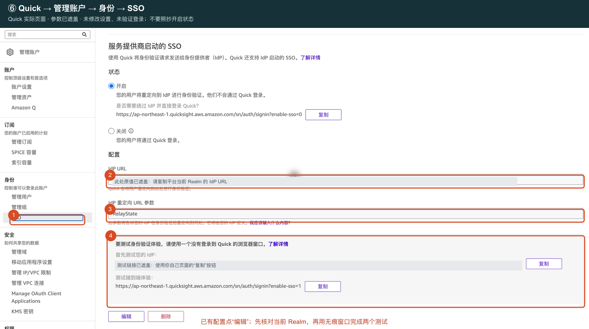

| 字段 | 本例填写 |
|---|---|
| IdP / SSO URL | `https://sso.example.com/realms/customer-quick/protocol/saml/clients/quick-web` |
| IdP 重定向 URL 参数 | `RelayState`，大小写一致 |

此 URL 最后的 quick-web 就是第 3 步自己定义的别名，不是 AWS 随机生成的值。不是 Metadata 下载地址，也不是 OIDC auth 地址。

先记录表内待填值，暂不启用账户级重定向。完成第 8 步启用 Provider 后，先直接打开上述 SSO URL 验证扫码进入 Quick；通过后在获批窗口回此页保存并启用 IdP 重定向，再从 Quick 正常入口验证退出重登。页面字段顺序以客户当前界面为准。应急管理员入口为 `https://ap-northeast-1.quicksight.aws.amazon.com/sn/auth/signin?enable-sso=0`，将区域替换为实际身份区域；仍需合法管理员认证。

首次配置按下面三步操作：

1. 填写 IdP URL 和 `RelayState`，保持「服务提供商启动的 SSO」关闭，点击页面底部 **保存**。成功后字段变为只读，按钮变为「编辑 / 删除」。
2. 首次扫码验证通过且获准启用后，选择「服务提供商启动的 SSO」的 **开启**，在「开启 SSO？」弹窗点击 **开启 SSO**。确认后即生效，**没有第二个底部保存按钮**。
3. 刷新页面，确认「开启」仍选中、URL 和 `RelayState` 均保留，并记录页面显示的管理员绕过入口。

仅填入文本、尚未保存时直接点开启，会提示“首先输入配置，在启动 SSO 之前，您需要先添加配置”。不要误开上方独立的「联合身份用户的电子邮件同步」选项，本方案已预注册用户，不依赖它。

仅在获批重做已有配置时：先把「服务提供商启动的 SSO」关闭并保存，再删除 SSO URL 配置；开启状态下界面会阻止删除。此操作影响整个 Quick 账户，先确认没有其他用户依赖它。

### Desktop：先 access，再 extension

**Manage account → Permissions → Extension access → Add extension access → Amazon Quick（Desktop application for Quick）→ Next**。

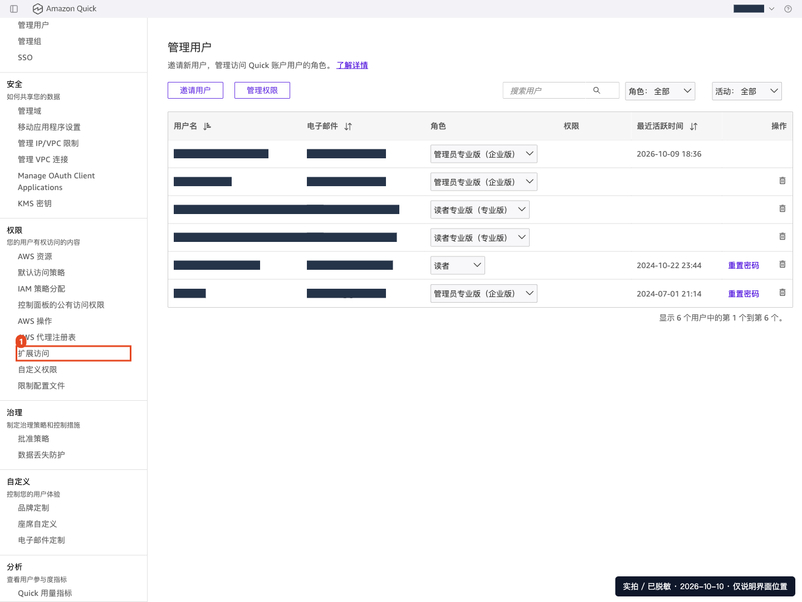

| 字段 | 本例填写 |
|---|---|
| Name | `CustomerQuick-Desktop-access` |
| Issuer URL | `https://sso.example.com/realms/customer-quick` |
| Authorization Endpoint | `https://sso.example.com/realms/customer-quick/protocol/openid-connect/auth` |
| Token Endpoint | `https://sso.example.com/realms/customer-quick/protocol/openid-connect/token` |
| JWKS URI | `https://sso.example.com/realms/customer-quick/protocol/openid-connect/certs` |
| Client ID | `amazon-quick-desktop` |

逐项核对 `.well-known/openid-configuration` 后点 **Add**。Public 客户端没有 Secret；此表单不强行填写不存在的 scopes 字段。所需 `openid profile email offline_access` 已在第 3 步配置。

然后进入 **Quick 主工作区 → 扩展（Extensions）→ 创建扩展**，选择刚创建的 Desktop access → **下一步**；名称填 `CustomerQuick-Desktop-extension`，点 **添加**。新卡片可能先显示“正在进行”，等待后刷新页面，确认变为“活跃”（Active），不要重复创建。

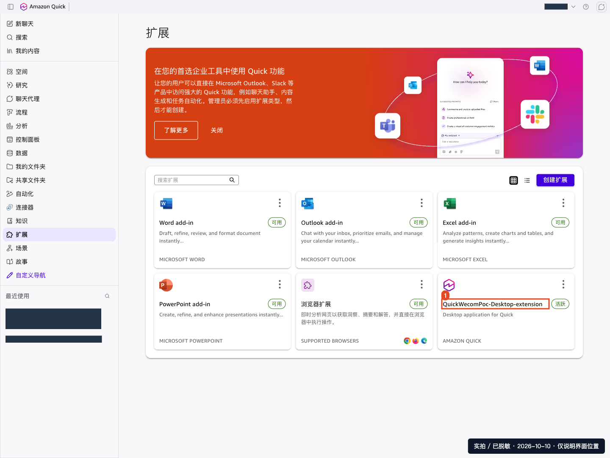

**检查：** access + extension 两者都存在，并指向同一个 Realm；它们不是每位员工各建一份。当前 access 的 Edit 只提供名称和描述，OIDC 参数变更需客户批准后重建。删除 access 的确认框会显示关联 extension 数量，并同时删除这些 extension；先核对名称和数量，不能边猜参数边删现有扩展。

## 8 · 启用扫码，按四项验收

先核对批准映射、稳定 subject、精确角色值、已注册 Quick 用户以及 Users=0，再回 Keycloak → **Identity providers → wecom-mapped → Enabled=On**。本版顶部 Enabled 开关会自动保存；刷新后确认仍为 On，不需要重复点击页面底部 Save。该操作开放此 Realm 的企微登录入口。

**执行顺序：先直接打开第 7 步的 SSO URL 完成本人扫码 → 管理员回 Quick「身份 → SSO」，先保存 URL / RelayState 配置，再选择「服务提供商启动的 SSO → 开启」，在弹窗确认「开启 SSO」 → 刷新确认开启状态和 URL 均保留 → 再验收正常入口和 Desktop。** 此开关是账户级设置，应保留独立管理员入口并在获批窗口启用。只保存 URL 不开启时，直连可以成功，但退出后从正常入口登录可能回到原生用户名页面。

**管理员与员工测试请使用不同浏览器或不同浏览器配置文件，不能只开两个标签页。** 同一浏览器中的 AWS/Quick 会话会共享：员工 SAML 登录后，原管理页可能变成员工身份。若 IAM 显示员工 RoleSessionName 且 `iam:GetRole` 无权限，这是角色隔离的正常结果，不要给员工追加 IAM 管理权限；回独立管理员会话继续配置。遇到 Quick「选择您的账户」页，选择本次扫码对应的员工角色，不要选择缓存的管理员。

| 验收 | 操作与通过标准 |
|---|---|
| Web 首次登录 | 员工在独立浏览器会话打开第 7 步的 SSO URL → 企业微信扫码 → 本人确认；Quick 用户名、邮箱、许可、可见内容正确 |
| Web 正常入口与退出重登 | 在独立员工浏览器打开客户区域的 Quick 登录页，输入客户账户名，确认进入企微认证并登录为正确员工；再退出 Quick，从同一正常入口重新登录。不能落入 AWS 选角色页面、产生新用户或提示身份未配置 |
| Desktop | Extensions 的 Desktop 卡片下载客户端 → Continue with SSO → 客户区域 → 本人扫码 → 本机 localhost:18080 回调；实际进入桌面主界面 |
| 身份与持续使用 | 已获批的不同员工各自验证隔离；获授权但未列入批准映射的测试成员应拒绝；Desktop 多次 token 刷新、休眠恢复及退出重登通过 |

二维码页面、HTTP 200、注册成功或 IAM 策略通过都不能代替上述真实登录。Keycloak 不存在持久员工或本地密码，不要再用临时密码登录。遇到 Quick 账号/用户选择页，选客户账号下的对应员工，而不是管理员或另一身份。Keycloak 或 Desktop 离线会话有效时可能不再显示二维码；验收首次扫码优先用另一台电脑，确需撤销时只处理获批测试员工的在线和 Desktop 离线会话，不能清除他人会话。

若 AWS 页面提示 **`Token must be redeemed within 5 minutes of issuance. Please try again.`**，表示本次联合登录令牌已超过兑换时限。关闭出错页，从客户区域的 Quick 登录入口重新发起认证并及时继续；不要刷新、后退或反复提交旧页面。此报错本身不代表 IAM 角色配置错误，不应据此放宽权限或延长会话。若全新登录立即出现同样报错，再排查服务器时钟偏差或旧认证响应被重复使用。

扫码故障需要停用时，将本 Realm 的 wecom-mapped Provider 关闭，**阻断后续扫码以及受控 Cookie 的新认证，不注销已建立会话、不撤销已签发 STS 凭证，也不停止 Quick 席位计费**。保留独立管理员，不要通过删除整个 Quick 订阅排查登录问题。

## 验收和资料边界

每次首次扫码、退出重登和 Desktop 登录后，都到当前业务 Realm → Users 查询，预期始终为 0。映射、在线/离线会话和日志仍含身份信息；这不是“没有个人数据”。不得为了看到某个员工而手工 Add user。

已有企业微信、Quick、IAM 图片为脱敏实拍；SAML/OIDC 图片来自已有隔离演示，属性填法以本版表格为准。新版手工全流程仍需在客户环境逐项验收，不能以脚本隔离测试替代手工 UI 验证或真实扫码。官方注册接口见 [RegisterUser](https://docs.aws.amazon.com/quicksight/latest/APIReference/API_RegisterUser.html)。

无需再执行迁移和 retire 清理。只有历史持久账号环境才使用 [旧账号迁移](管理员映射临时用户实施.md)。
